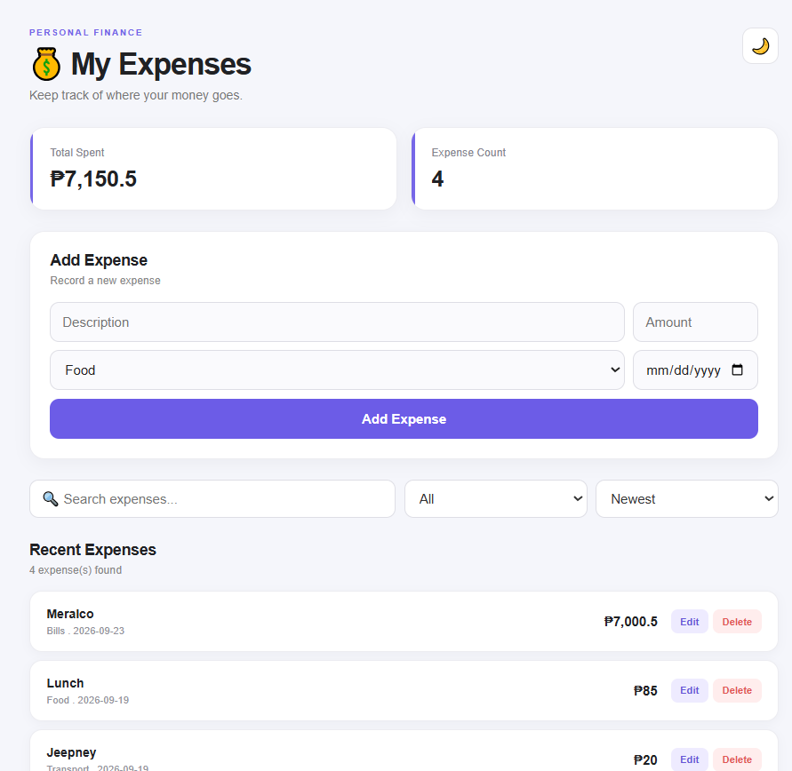

# 💰 Expense Tracker



A responsive expense tracking application built with React that allows users to manage, search, filter, edit, and delete expenses.

## 📖 About

This project is a React-based expense tracker built to practice creating a complete frontend application with reusable components, state management, form handling, filtering, and CRUD operations.

Users can add expenses, view their expense list, search for specific expenses, filter expenses by category, edit existing expenses, and delete expenses with a confirmation dialog.

The project also includes an expense statistics section that provides a quick overview of the user's expenses.

## ✨ Features

* ➕ Add new expenses
* ✏️ Edit existing expenses
* 🗑️ Delete expenses with confirmation
* 🔎 Search expenses
* 🏷️ Filter expenses by category
* 💰 Track expense amounts
* 📊 View expense statistics
* ✅ Form validation
* ⚠️ Error handling
* 📱 Responsive design
* 🧩 Reusable React components
* 📂 Expense data stored in JSON
* 📂 Categories stored in JSON

## 🛠️ Technologies

* React.js
* JavaScript (ES6+)
* CSS3
* Vite
* Git
* GitHub

## ⚛️ React Concepts Used

This project helped me practice:

* `useState`
* Props
* Event handling
* Controlled inputs
* Conditional rendering
* Component composition
* Array methods such as `map`, `filter`, and `find`
* Form handling
* Data validation
* Reusable components
* Managing state between components
* Dialog components
* Working with JSON data

## 📂 Project Structure

```text
src/
├── components/
│   ├── CategoryFilter.jsx
│   ├── DeleteDialog.jsx
│   ├── EditDialog.jsx
│   ├── ExpenseForm.jsx
│   ├── ExpenseItem.jsx
│   ├── ExpenseList.jsx
│   ├── ExpenseStats.jsx
│   └── SearchBar.jsx
│
├── data/
│   ├── categories.json
│   └── expenses.json
│
├── App.jsx
├── App.css
├── index.css
└── main.jsx
```

## 📊 Expense Management

Each expense can contain information such as:

* Expense title
* Amount
* Category

The application allows expenses to be created, displayed, edited, searched, filtered, and deleted.

## 🔎 Search & Filtering

The search feature allows users to quickly find expenses.

The category filter can be used to display expenses belonging to a specific category.

These features work together to make managing a larger list of expenses easier.

## 📝 Forms & Validation

The expense form includes validation to prevent invalid or incomplete expense entries.

The edit form uses a separate dialog component, while deleting an expense requires confirmation through a delete dialog.

## 📊 Expense Statistics

The statistics section provides a quick overview of the expense data and updates when expenses are added, edited, or deleted.

## 🎯 What I Learned

Through this project, I practiced building a React application with multiple interacting components and learned how to manage data across a larger component structure.

Some of the main things I learned were:

* Managing application state with React
* Passing data through props
* Handling forms and validation
* Creating reusable components
* Filtering and searching data
* Editing and deleting data
* Creating confirmation dialogs
* Separating data into JSON files
* Organizing a React project
* Writing reusable CSS
* Building responsive interfaces

## 🚀 Future Improvements

Possible future improvements include:

* 💾 LocalStorage persistence
* 📅 Expense dates
* 📈 Expense charts
* 💵 Monthly spending summaries
* 📤 Export expenses
* 🌙 Dark mode
* 🔐 User accounts and authentication
* ☁️ Backend/database integration

## 👨‍💻 Project

Built as a learning project while studying React and frontend development.
